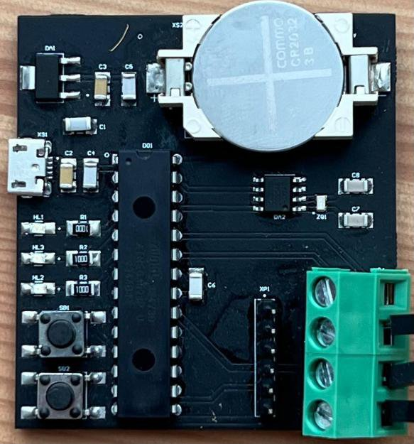
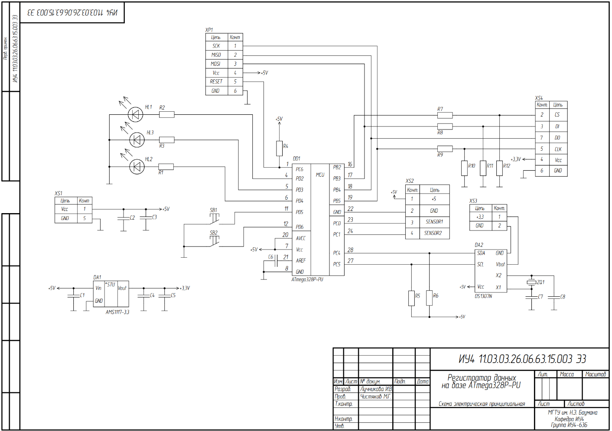
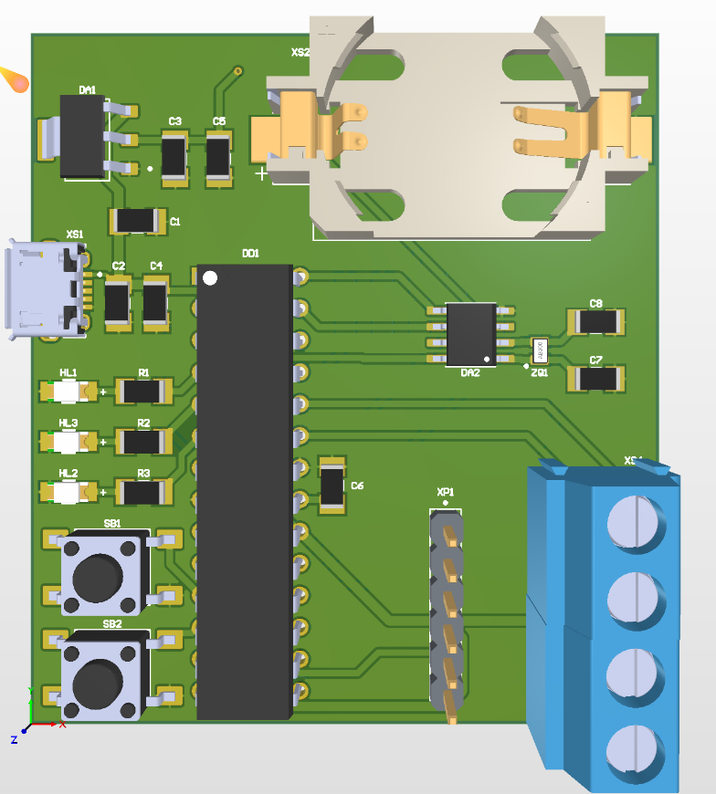
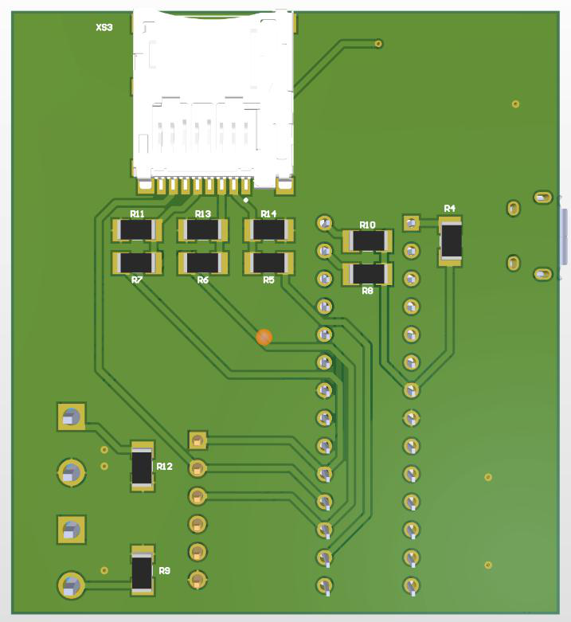
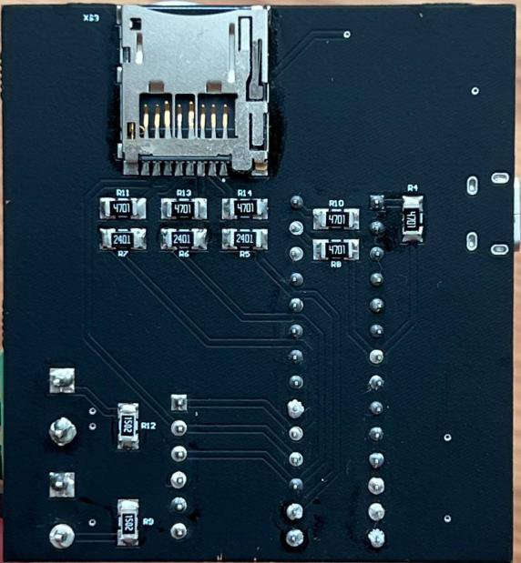
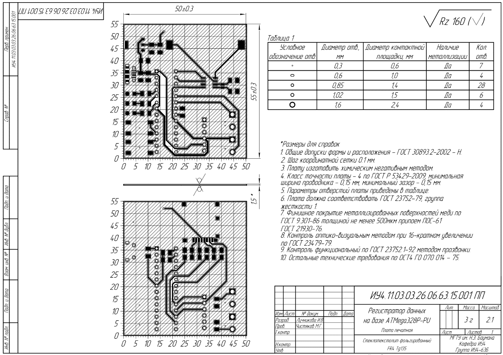
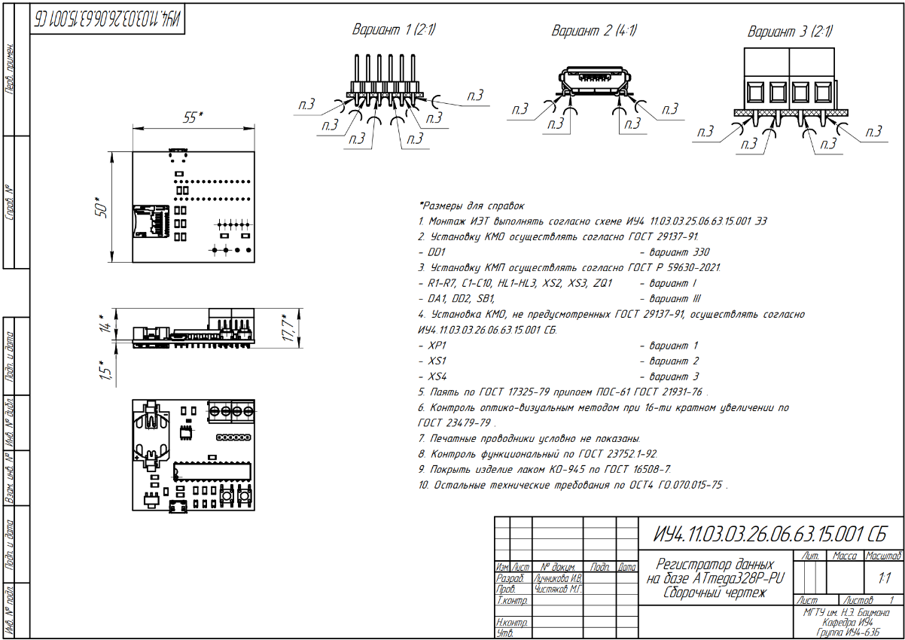

# Регистратор аналоговых данных на базе ATmega328P-PU

[](https://www.microchip.com/en-us/product/atmega328p)
[](#-прошивка)
[](#-печатная-плата)
[](LICENSE)

Автономный двухканальный регистратор (data logger) аналоговых сигналов с записью на microSD-карту и метками времени от часов реального времени DS1307. Курсовая работа по кафедре ИУ4 «Проектирование и технология производства электронной аппаратуры» МГТУ им. Н. Э. Баумана.

<p align="center">
  
  
</p>

<details>
<summary><b>🇬🇧 English summary</b></summary>

**Analog Data Logger based on ATmega328P-PU** — a standalone two-channel data logger that samples analog sensors (A0/A1), timestamps every sample with a DS1307 real-time clock and writes the data to a microSD card (FAT32) as plain text files. Sampling interval, time and date are set through a `CONFIG.TXT` file on the card — no reflashing required. Three LEDs indicate the device state (ready / recording / SD or RTC error); two push-buttons start/stop logging and reset the file counter.

The repository contains the firmware (Arduino IDE), the schematic and PCB design (Altium Designer, 2-layer 50 × 55 mm board manufactured by Rezonit), the Proteus 8 simulation model, the full set of GOST (ЕСКД) design documents and the course-work report (in Russian).

Developed as a course project at the Department IU4 "Design and Technology of Electronic Equipment", Bauman Moscow State Technical University.

</details>

## О проекте

Устройство предназначено для периодического считывания аналоговых сигналов с датчиков и сохранения результатов на SD-карту с указанием времени измерения. Интервал выборки, а также текущие время и дата задаются текстовым конфигурационным файлом на карте памяти, поэтому перенастройка регистратора не требует перепрошивки микроконтроллера.

В рамках работы выполнен полный цикл разработки электронного устройства:

| Этап | Инструмент | Результат |
|---|---|---|
| Техническое задание, структурная (Э1) и функциональная (Э2) схемы | КОМПАС-3D | чертежи по ГОСТ 2.701-2008 |
| Моделирование | Proteus 8 | проверка алгоритма и индикации до изготовления платы |
| Принципиальная схема (Э3), перечень элементов (ПЭ3) | Altium Designer | схема по ГОСТ 2.702-2011 |
| Топология печатной платы, чертёж ПП, сборочный чертёж, спецификация | Altium Designer | ДПП 50 × 55 мм, 3-й класс точности по ГОСТ Р 53429-2009 |
| Изготовление платы | ООО «Резонит» | опытный образец |
| Прошивка | Arduino IDE (C++) | алгоритм ПД1 |
| Экспериментальное исследование | — | сравнение с моделью (плакат ПД2) |


## Возможности

- 2 аналоговых канала (входы A0 и A1 АЦП ATmega328P, 10 бит);
- метки времени от RTC DS1307 с резервным питанием от батарейки CR2032;
- запись на microSD-карту (FAT32) в текстовые файлы — по одному файлу на канал, нумерация сеансов автоматическая;
- настройка времени, даты и интервала выборки через `CONFIG.TXT` без перепрошивки;
- светодиодная индикация готовности, записи и ошибок инициализации;
- кнопки пуск/стоп записи и сброса счётчика файлов;
- питание 5 В через разъём micro-USB, встроенный стабилизатор 3,3 В для SD-карты;
- программирование по ISP через 6-контактный штыревой разъём на плате.

## Режимы работы и индикация

| Состояние | HL1 (синий) | HL2 (зелёный) | HL3 (красный) | Комментарий |
|---|:-:|:-:|:-:|---|
| Ошибка инициализации RTC | — | мигает | — | бесконечный цикл, запись не ведётся |
| Ошибка инициализации SD-карты | — | — | мигает | бесконечный цикл, запись не ведётся |
| Готовность (ожидание) | — | горит | — | конфигурация прочитана, ждём нажатия SB1 |
| Запись данных | — | горит | вспышка на каждом пакете | пакет = одна выборка с обоих каналов |
| Запись каждого 5-го пакета | вспышка | горит | вспышка | визуальный счётчик пакетов |

Кнопки:

| Кнопка | Вывод МК | Функция |
|---|---|---|
| **SB1** | PD5 | пуск / остановка записи |
| **SB2** | PD6 | сброс порядкового номера файлов (следующий сеанс начнётся с `*_001.TXT`) |

## Структура репозитория

```text
.
├── firmware/             # прошивка для PlatformIO
├── hardware/
│   ├── altium/           # проект Altium Designer: схема Э3, топология ПП, библиотеки
│   └── 3dmodel           # 3D модель платы
├── docs/
│   └── images/           # иллюстрации для этого README
├── LICENSE
└── README.md
```

---

## 🔧 Аппаратная часть

### Структурная и функциональная схемы

<p align="center">
  
  
</p>

Устройство состоит из следующих функциональных узлов:

- **микроконтроллер** ATmega328P-PU (DIP-28) — управление всеми процессами;
- **часы реального времени** DS1307 с кварцевым резонатором 32,768 кГц и резервной батареей CR2032 (шина I²C);
- **модуль хранения данных** — слот microSD (шина SPI, питание 3,3 В);
- **линейный стабилизатор** AMS1117-3.3 — формирует 3,3 В из входных 5 В;
- **индикация** — три светодиода HL1–HL3;
- **кнопки настройки** SB1, SB2;
- **разъём аналоговых датчиков** (+5 В, GND, SENSOR1, SENSOR2) — винтовые клеммники;
- **разъём ISP** для программирования.

### Принципиальная схема

<p align="center">
  
</p>


- Питание +5 В подаётся через micro-USB (XS1). Стабилизатор DA1 (AMS1117-3.3) формирует +3,3 В для SD-карты. На линиях SPI между микроконтроллером (5 В) и картой (3,3 В) установлены резисторы согласования уровней R7–R12.
- DA2 (DS1307) подключена к микроконтроллеру по I²C (подтяжки R5, R6 — 4,7 кОм). Резервное питание RTC — CR2032 в держателе XS3.
- Светодиоды HL1–HL3 включены через токоограничивающие резисторы R1–R3 (100 Ом).
- Кнопки SB1, SB2 замыкают входы PD5/PD6 на землю (используются внутренние подтяжки МК).
- Вывод RESET подтянут к +5 В резистором R4; разъём XP1 (PLS-6) выведен для внутрисхемного программирования.
- Внешнего кварцевого резонатора у микроконтроллера на плате нет — тактирование от внутреннего RC-генератора 8 МГц.


### 🟩 Печатная плата

Двусторонняя печатная плата **50 × 55 мм**, 3-й класс точности (ГОСТ Р 53429-2009), 49 отверстий, габариты собранной ячейки 50 × 55 × 17,7 мм. Разработана в Altium Designer, изготовлена на производстве «Резонит». Пассивные компоненты — типоразмер 1206, микроконтроллер — в корпусе DIP-28.

<p align="center">
  
  
</p>

<p align="center">
  
  
</p>

<details>
<summary>Чертёж печатной платы и сборочный чертёж</summary>
<p align="center">
  
  
</p>
</details>


### Алгоритм работы

<p align="center">
  
</p>

1. **Инициализация.** После подачи питания настраиваются выводы светодиодов и кнопок, инициализируются RTC (I²C) и SD-карта (SPI). При ошибке RTC — бесконечное мигание зелёного HL2, при ошибке SD — красного HL3; дальнейшая работа блокируется.
2. **Чтение конфигурации.** С карты читается `CONFIG.TXT`. Если файла нет, он создаётся со значениями по умолчанию. Параметры `TIME` и `DATE` записываются в RTC, `INTERVAL` задаёт период выборки.
3. **Готовность.** Загорается зелёный HL2. В главном цикле с программным антидребезгом опрашиваются кнопки.
4. **Старт записи (SB1).** Определяется следующий свободный номер `NNN`, создаются файлы `TEMP_NNN.TXT` и `WATR_NNN.TXT`, счётчик пакетов обнуляется, первая выборка выполняется немедленно.
5. **Запись.** Каждые `INTERVAL` секунд считываются значения АЦП с A0 и A1, запрашивается время у RTC, строки добавляются в оба файла. При записи вспыхивает красный HL3, на каждом пятом пакете — ещё и синий HL1. Ошибки записи отдельных пакетов игнорируются.
6. **Стоп (SB1 повторно)** — возврат в режим готовности. **SB2** сбрасывает номер файлов на `001`.


## 📊 Экспериментальное исследование

На опытном образце проверены все режимы, описанные в ТЗ: ошибка инициализации SD-карты, успешная инициализация, чтение конфигурации, старт записи по SB1 (интервал 5 с), индикация каждого пятого пакета, анализ записанных файлов. 
Результаты эксперимента совпадают с результатами моделирования; расхождения объясняются допусками компонентов и условиями измерений. Сравнительный плакат (ПД2):

<p align="center">
  
</p>

